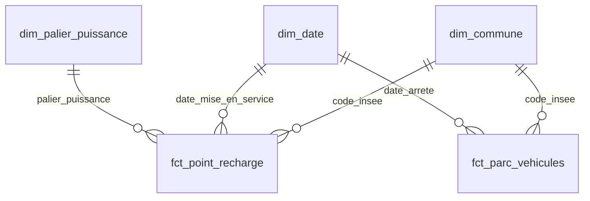

# ⚡ Recharge électrique en France : où les bornes manquent-elles ?

> Analyse de l'adéquation entre le parc de voitures électriques et l'infrastructure de recharge publique, à l'échelle des communes et des départements français.

**Statut :** 🚧 en cours — semaine 2/4 (modèle en étoile BigQuery)

---

## 🎯 Problématique

Le parc de voitures électriques progresse rapidement en France. Les points de recharge publics suivent-ils le rythme partout ?

Ce projet identifie les **territoires sous-équipés**, où le nombre de véhicules électriques par point de recharge est le plus élevé, et suit l'évolution de cet écart dans le temps.

## 📊 Indicateurs clés

| Indicateur | Définition |
|---|---|
| Ratio de tension | Véhicules électriques / points de recharge publics |
| Densité de recharge | Points de recharge pour 10 000 habitants |
| Part de recharge rapide | Points > 50 kW / total des points |
| Dynamique | Croissance annuelle du parc électrique vs des points de recharge |

## 🏗️ Architecture

```
 Open data (data.gouv.fr, geo.api.gouv.fr)
        │
        ▼
 [1] src/ingest.py   ── téléchargement + manifeste de provenance ──►  data/raw/
        │
        ▼
 [2] src/clean.py    ── nettoyage + contrôles qualité ──►  data/processed/*.parquet
        │                                                   reports/qualite_donnees.md
        ▼
 [3] BigQuery        ── sql/*.sql : modèle en étoile + vues KPI ──►  dataset mart
        │
        ▼
 [4] Power BI + Looker Studio  ── dashboards                         (semaine 3)
```

## 📁 Sources de données

| Source | Producteur | Granularité | Licence |
|---|---|---|---|
| [Base nationale consolidée IRVE (données statiques)](https://www.data.gouv.fr/datasets/beta-bases-nationales-des-points-de-recharge-pour-vehicules-electriques-en-france-irve) | Point d'Accès National transport.data.gouv.fr | Point de recharge | Licence Ouverte 2.0 |
| [Voitures particulières immatriculées par commune et par type de recharge](https://www.data.gouv.fr/datasets/voitures-particulieres-immatriculees-par-commune-et-par-type-de-recharge-jeu-de-donnees-aaadata) | Agence ORE / AAA Data | Commune × trimestre | Licence Ouverte 2.0 |
| [API Découpage administratif](https://geo.api.gouv.fr/decoupage-administratif) | Etalab | Commune (+ population) | Licence Ouverte 2.0 |

## 🧹 Qualité des données

Le nettoyage applique des règles explicites, chacune chiffrée dans [`reports/qualite_donnees.md`](reports/qualite_donnees.md). Résultat clé : **99,96 % des 170 624 points de recharge rattachés à une commune**, dont 26 % récupérés grâce à leurs coordonnées GPS car leur code commune était vide.


- **Doublons** : suppression sur l'identifiant unique du point de recharge (`id_pdc_itinerance`).
- **Unités** : puissances saisies en watts au lieu de kilowatts détectées et converties.
- **Valeurs aberrantes** : puissances hors [1 ; 1000] kW et dates de mise en service incohérentes (avant 2010 ou dans le futur) mises à vide plutôt que supprimées.
- **Rattachement aux communes** : environ un quart des points de recharge n'ont pas de code INSEE exploitable. Ils sont rattachés par ordre de fiabilité : code INSEE déclaré, puis code postal saisi à la place du code INSEE, puis **coordonnées GPS** (commune dont le centre est le plus proche, à moins de 15 km). Chaque point garde la méthode utilisée dans `methode_rattachement`.
- **Codes INSEE** : normalisation sur 5 caractères (Corse `2A`/`2B` comprise), arrondissements de Paris, Lyon et Marseille ramenés à leur commune pour que les sources se joignent correctement.
- **Cohérence** : exclusion des lignes où le nombre de véhicules électriques dépasse le parc total.
- **Traçabilité** : un manifeste (`data/raw/manifest.json`) date chaque téléchargement.

## 🗄️ Modèle de données

Modèle en étoile dans BigQuery (scripts dans [`sql/`](sql/), détail dans [`docs/modele_donnees.md`](docs/modele_donnees.md)) :



- **`fct_point_recharge`** — 1 ligne par point de recharge public (≈ 170 000)
- **`fct_parc_vehicules`** — 1 ligne par commune et par trimestre (stock semi-additif : jamais sommé entre trimestres)
- **Vues d'analyse** — `v_tension_departement`, `v_tension_commune`, `v_evolution_trimestrielle`, consommées par les dashboards

## ⚠️ Limites connues

- Le rattachement par coordonnées GPS utilise le centre de la commune la plus proche : près d'une limite communale, un point peut être attribué à la commune voisine. L'effet est négligeable à la maille départementale.
- Les véhicules sont rattachés à l'**adresse d'immatriculation**. Les flottes d'entreprise et de loueurs gonflent artificiellement certaines communes (sièges sociaux, zones aéroportuaires). L'analyse au niveau **départemental** atténue ce biais.
- Environ **49 % des points n'ont pas de date de mise en service**. Les indicateurs « photo à date » utilisent tous les points ; la courbe d'évolution n'utilise que les points datés et sous-estime donc le niveau (la tendance reste exploitable).
- La base IRVE ne couvre que la **recharge ouverte au public**, pas la recharge à domicile ou en entreprise.
- La base IRVE consolidée est en version **bêta** et dépend des déclarations des aménageurs.

## 🚀 Reproduire le projet

**Windows :** double-cliquez sur `lancer.bat` (crée l'environnement, télécharge et nettoie les données).

**Manuellement :**

```bash
git clone https://github.com/sabcelia1/recharge-ve-france.git
cd recharge-ve-france
python -m venv .venv
source .venv/bin/activate          # Windows : .venv\Scripts\activate
pip install -r requirements.txt

python src/ingest.py               # ~180 Mo de téléchargement
python src/clean.py                # tables propres + rapport qualité
jupyter notebook notebooks/01_exploration.ipynb
```

**BigQuery :** suivre [`docs/guide_bigquery.md`](docs/guide_bigquery.md) (import des 3 fichiers Parquet puis exécution des scripts `sql/` dans l'ordre).

## 🗺️ Feuille de route

- [x] **Semaine 1** — Ingestion, nettoyage, rapport qualité, exploration
- [x] **Semaine 2** — Modèle en étoile BigQuery, vues d'analyse SQL
- [ ] **Semaine 3** — Dashboard Power BI (.pbip) et version Looker Studio
- [ ] **Semaine 4** — Conclusions, captures, publication

## 🛠️ Stack

Python (pandas, scipy, requests) · SQL · Google BigQuery · Power BI (DAX, Power Query) · Looker Studio

---

👤 **Célia Monga** — Ingénieure Data & IA · [LinkedIn](https://www.linkedin.com/in/c%C3%A9lia-monga-a48b48242/)
