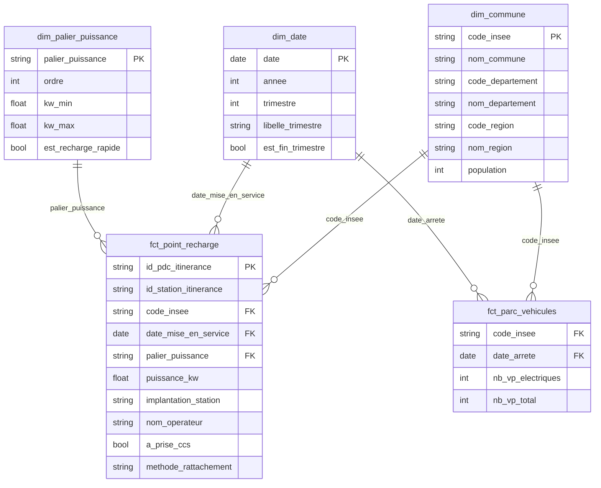

# Modèle de données

Modèle en étoile construit dans BigQuery à partir des tables nettoyées (`src/clean.py`).
Deux tables de faits partagent les mêmes dimensions (constellation de faits).

## Grain des tables de faits

| Table | Grain | Type de mesure |
|---|---|---|
| `fct_point_recharge` | 1 point de recharge public | Additive (on peut compter et sommer) |
| `fct_parc_vehicules` | 1 commune × 1 trimestre | **Semi-additive** : stock à une date, se somme entre communes mais **jamais entre trimestres** |

## Choix de modélisation

- **Hiérarchie géographique dénormalisée** dans `dim_commune` (commune > département > région) : un seul niveau de jointure, plus simple pour Power BI.
- **`dim_date` générée en SQL** (`GENERATE_DATE_ARRAY`) plutôt qu'importée : elle couvre toujours toutes les dates des faits.
- **Intégrité référentielle** : les faits dont la commune n'existe pas dans le référentiel sont exclus (< 1 %), et des requêtes de contrôle sont fournies en fin de `sql/02_faits.sql`.
- **Dates de mise en service manquantes** (≈ 49 % des points) : conservées à `NULL` plutôt qu'inventées. Les indicateurs « photo à date » utilisent tous les points ; la courbe d'évolution n'utilise que les points datés et le signale.
- **Traçabilité** : `methode_rattachement` indique comment chaque point a été rattaché à sa commune (code INSEE, code postal ou GPS).

## Vues d'analyse (`sql/03_analyses.sql`)

| Vue | Usage |
|---|---|
| `v_tension_departement` | KPI par département : VE par point, points pour 10 000 habitants, part de recharge rapide, classement |
| `v_tension_commune` | Zoom commune, avec un indicateur `suspicion_flotte` (plus de 2 voitures par habitant) |
| `v_evolution_trimestrielle` | Dynamique nationale du parc VE et des points datés |
